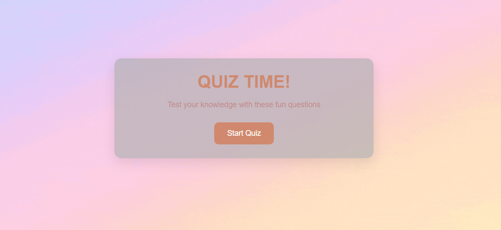

  
<h1> FUN QUIZ TIME </h1>
  

A cute pastel quiz with riddles and trick questions. You answer, hear a sound, and see your score at the end.

## Description

This is my first project with HTML, CSS, and JavaScript. 
The quiz has 10 riddles and questions. 
Each question has four answers. 
When you click one, the right answer turns green and a sound plays. 
A progress bar shows how far you are, and the last screen shows your score. 
The quiz is not hard, but some questions are tricky, so read carefully.

<h2> Getting Started </h2>

### Dependencies

- A web browser (Chrome, Edge, Firefox, or Safari)
- Nothing else. There is nothing to install.

 ### Installing

- Download or clone this repository
- Keep all files in the same folder: `index.html`, `script.js`, `style.css`, `cute.gif`, `correct_answer.mp3`, and `wrong_answer.mp3`

### Executing program

- Play online: [https://syhavvs.github.io/fun-quiz-time/](https://syhavvs.github.io/fun-quiz-time/)
- Or play on your computer: open `index.html` in your browser
- Click **Start Quiz**, pick an answer for each question, and see your score at the end
- Click **Restart Quiz** to play again.

## Help

- **No sound?** Turn up your volume. Check that the sound files are in the same folder as `index.html` and that the names match the code exactly.
- **Background is not moving or showing?** Make sure `cute.gif` is in the same folder.
- **Buttons do not work?** Press F12, open the **Console** tab, and look for red error messages.

  
## Features

- 10 riddles and questions, with four answer choices each.
- After you click, the right answer turns green, and your pick turns red if it was wrong.
- A "ding" plays for correct answers and a different sound for wrong ones too.
- The background is a soft pastel GIF.
- There is a scoreboard for your end result.
- Some questions are easy, and some are tricky, so read carefully.

## How I made it

I chose this project as my first because the basic code structure is simple.
It's a soft pastel theme to match the energy of the quiz's questions.
My biggest problem was the sound!! Wrong answers played a sound, but correct ones were silent. The code was fine, so I opened the browser's console and checked the file names. They didn't match my code; it said "correct answer.mp3" with a space, but the file was "correct_answer.mp3" with an underscore. So I fixed it.
I also found that the score was counted twice because I had written the same code in two different places.
The questions are stored in a list in the code, and each answer is marked as correct or not, so the same code can show any question.

## What I learned

A tiny typo, even a comma, can break a page or show up as a strange dot. 
I learned to use the Console to find problems instead of guessing. 
Next, I want to add background music with a mute button, and also add more questions and shuffle them.

## Credits

- [Correct answer sound (Pixabay)](https://pixabay.com/sound-effects/technology-correct-472358/)
- [Wrong answer sound (Pixabay)](https://pixabay.com/sound-effects/film-special-effects-wrong-answer-126515/)
- [Pastel gradient background GIF (Giphy)](https://giphy.com/gifs/background-rainbow-scroll-gradient-dYtHPYJxZblCcWPwcQ)

## License

This project is licensed under the [NAME HERE] License - see the LICENSE file for details
